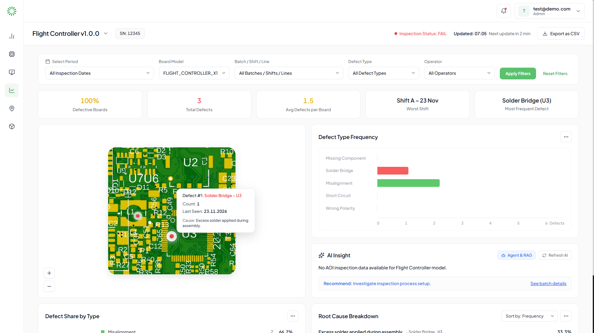
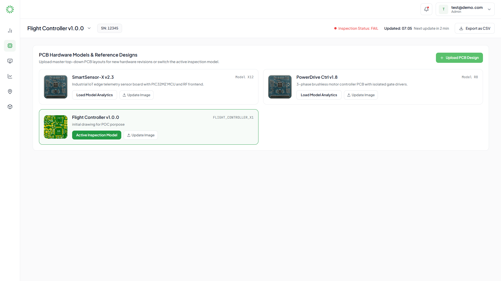
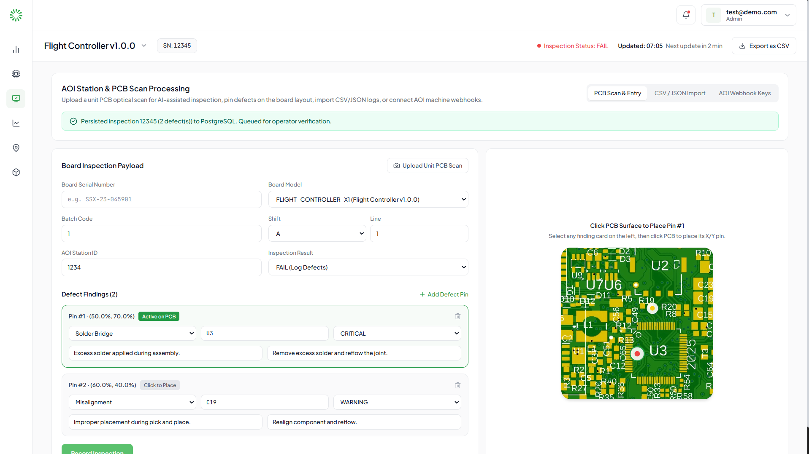
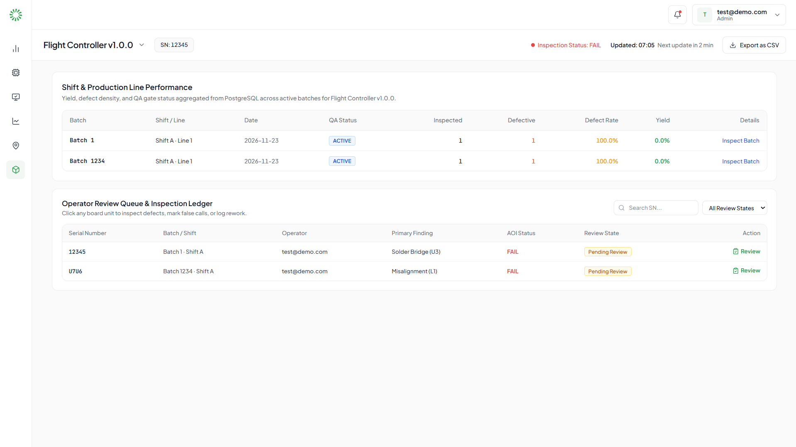
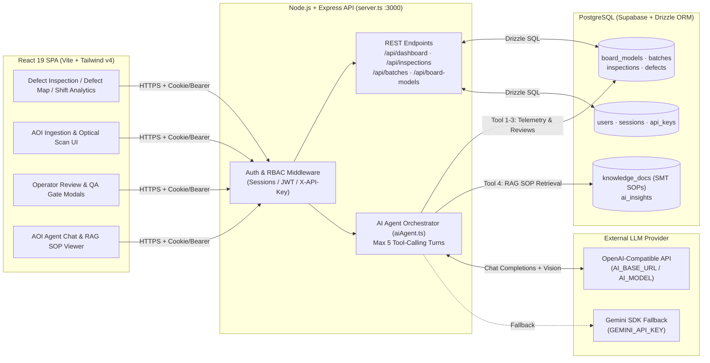

<div align="center">

# Board Sight

**AI-Assisted PCB Automated Optical Inspection (AOI), Defect Mapping & Agentic Root-Cause Analytics**

[](https://www.typescriptlang.org/)
[](https://react.dev/)
[](https://expressjs.com/)
[](https://www.postgresql.org/)
[](https://orm.drizzle.team/)
[](https://tailwindcss.com/)
[](#apps-system-architecture)

</div>

---

## Visual Overview

<p align="center">
  
</p>

<table>
  <tr>
    <td width="33.33%" align="center">
      
      <br />
      <sub><strong>Board Models</strong> — Master PCB layout &amp; revision registry</sub>
    </td>
    <td width="33.33%" align="center">
      
      <br />
      <sub><strong>AOI Ingestion</strong> — Unit PCB scan, AI Vision &amp; coordinate pinning</sub>
    </td>
    <td width="33.33%" align="center">
      
      <br />
      <sub><strong>Shift Analytics</strong> — Batch QA gate &amp; operator disposition queue</sub>
    </td>
  </tr>
</table>

---

## Key Capabilities

- **Spatial PCB Defect Mapping** — Interactive zoomable PCB board overlay pinning `Missing Component`, `Solder Bridge`, `Misalignment`, `Short Circuit`, and `Wrong Polarity` hotspots with component references and root-cause telemetry.
- **Full AOI Inspection Lifecycle** — Register master PCB reference layouts (`Board Models`), upload unit scan photos or CSV/JSON machine logs (`AOI Ingestion`), verify/dispute findings (`Operator Review Queue`), and enforce QA batch gates (`ACTIVE` / `HOLD_REVIEW` / `RELEASED`).
- **Multi-Turn Tool-Calling AI Agent & PostgreSQL RAG** — Connects to any **OpenAI-compatible** endpoint (`AI_BASE_URL`, `AI_KEY`, `AI_MODEL`, with Gemini fallback) and executes live PostgreSQL telemetry queries alongside IPC-A-610 / SMT SOP retrieval (`knowledge_docs`).
- **Role-Based Auth & Machine Webhooks** — Cookie + Bearer token sessions (`bcrypt` + HMAC JWT), login rate-limiting, CSV exports, and SHA-256 hashed AOI station API keys (`X-API-Key`).

---

## Project Structure

```text
.
├── docs/                                # README & UI documentation screenshots
│   ├── defect-inspection-dashboard.png
│   ├── board-models.png
│   ├── aoi-ingestion.png
│   └── shift-analytics-review.png
├── server/
│   ├── aiAgent.ts                       # Multi-turn tool-calling Agent, Vision scan & PostgreSQL RAG
│   ├── auth.ts                          # Password hashing, JWT sessions, API key auth & rate limiting
│   └── routes.ts                        # Express REST API (/api/auth, /api/dashboard, /api/inspections, /api/ai)
├── src/
│   ├── components/
│   │   ├── AgentAssistantModal.tsx      # Interactive Agent chat & SMT RAG SOP manager
│   │   ├── AuthScreen.tsx               # Sign-in / registration workspace
│   │   ├── BatchDetailsModal.tsx        # Batch yield telemetry & QA Hold/Release controls
│   │   ├── BrandLogo.tsx                # Board Sight SVG mark
│   │   ├── DefectFrequencyChart.tsx     # Horizontal defect distribution bar chart
│   │   ├── DefectShareCard.tsx          # Defect share donut breakdown
│   │   ├── IngestionView.tsx            # Manual scan, AI optical vision, CSV/JSON & webhook keys
│   │   ├── InspectionReviewModal.tsx    # Per-defect verification & unit disposition modal
│   │   ├── MarkdownContent.tsx          # GFM Markdown renderer for Agent & SOP responses
│   │   ├── PcbDefectMap.tsx             # Interactive PCB canvas with coordinate markers & zoom
│   │   ├── RootCauseCard.tsx            # Ranked root-cause contributor table
│   │   └── SecondaryViews.tsx           # Shift Analytics, Board Models & Defect Map Explorer views
│   ├── db/
│   │   ├── index.ts                     # PostgreSQL connection pool & Drizzle client
│   │   ├── schema.ts                    # Relational tables (users, board_models, batches, inspections, defects, ai_insights, knowledge_docs)
│   │   └── seed.ts                      # Initial production baseline & IPC-A-610 SMT SOP seeder
│   ├── lib/
│   │   ├── api.ts                       # Authenticated fetch wrapper (Cookie + Bearer token)
│   │   └── imageUpload.ts               # Client-side PCB image resize & compression helper
│   ├── types/
│   │   └── boardsight.ts                # Shared frontend TypeScript contracts
│   ├── App.tsx                          # Main shell, global design dropdown & Defect Inspection dashboard
│   ├── index.css                        # Tailwind CSS v4 entry & typography rules
│   └── main.tsx                         # React DOM root
├── server.ts                            # Unified Express + Vite (dev) / static SPA (prod) server on port 3000
├── drizzle.config.ts                    # Drizzle Kit PostgreSQL migration config
├── vite.config.ts                       # Vite bundler + Tailwind CSS plugin
├── package.json
└── .env.example
```

---

## Apps System Architecture



### Request & Agent Tool-Calling Flow

1. **Ingestion & Calibration** — AOI stations (via `X-API-Key` webhook) or operators (via manual scan / AI optical vision / CSV import) persist unit records into `inspections`, `defects`, and `batches` inside a PostgreSQL transaction.
2. **Operator Verification & QA Gate** — Operators review pending units (`PENDING_REVIEW` -> `CONFIRMED_FAIL`, `FALSE_CALL`, `REWORKED`, `SCRAPPED`), automatically recalculating batch `defective_boards` counts. QA Engineers/Admins can place batches on `HOLD_REVIEW` or `RELEASED`.
3. **Agentic RAG Analysis** — When triggered via **Refresh AI** or **Agent & RAG**, `server/aiAgent.ts` equips the configured LLM with 4 live PostgreSQL tools (`get_shift_batch_metrics`, `get_component_hotspots`, `get_recent_unit_reviews`, `search_smt_knowledge_rag`), grounding recommendations in actual shop-floor telemetry and stored IPC-A-610 SOPs.

---

## Tech Stack

| Layer | Technology |
| :--- | :--- |
| **Frontend** | React 19, TypeScript, Vite 8, Tailwind CSS v4, Lucide Icons, `react-markdown`, `remark-gfm` |
| **Backend** | Node.js, Express 4, Zod validation, `tsx` runtime |
| **Database & ORM** | PostgreSQL (Supabase Pooler), Drizzle ORM, `drizzle-kit`, `pg` |
| **Authentication & Security** | `bcryptjs`, `jsonwebtoken`, `cookie-parser`, login rate-limiting, SHA-256 machine API keys |
| **AI & Vision** | OpenAI-Compatible `/chat/completions` (`fetch` tool loop + vision), `@google/genai` fallback, PostgreSQL RAG |

---

## How to Build

### 1. Prerequisites

- **Node.js** `>= 20`
- **PostgreSQL** instance (e.g., Supabase PostgreSQL or local Postgres)
- An **OpenAI-compatible API endpoint** (OpenAI, OpenRouter, Groq, DeepSeek, Ollama, vLLM, LiteLLM) or `GEMINI_API_KEY`

### 2. Install Dependencies

```bash
npm install
```

### 3. Configure Environment Variables

Copy `.env.example` to `.env` and fill in your credentials:

```bash
cp .env.example .env
```

```dotenv
# OpenAI-Compatible AI Agent & Vision Service (Primary)
AI_BASE_URL="https://api.openai.com/v1"
AI_KEY="your-openai-compatible-api-key"
AI_MODEL="gpt-4o-mini"

# Optional fallback if AI_KEY is left empty
GEMINI_API_KEY=""

# PostgreSQL Connection
DB_HOST="your-postgres-host"
DB_PORT="5432"
DB_NAME="postgres"
DB_USER="postgres"
DB_PASSWORD="your-db-password"
DB_SSL="true"

# Session & Cookie Signing Secret
AUTH_SECRET="replace-with-random-64-char-hex-secret"
```

### 4. Push Database Schema & Run Typecheck / Production Build

```bash
# Sync Drizzle schema to PostgreSQL
npx drizzle-kit push

# Run TypeScript check
npm run lint

# Build Vite frontend bundle into dist/
npm run build
```

### 5. Run Locally (Development)

```bash
npm run dev
```

The server starts on `http://localhost:3000` with Express API routes and Vite middleware attached, automatically seeding baseline board models and SMT RAG SOPs on first boot.

---

## How to Deploy

Board Sight runs as a **single unified Node.js service** (`server.ts`) that serves both `/api/*` endpoints and the compiled Vite SPA from `dist/` on port `3000` (or `process.env.PORT`).

### Option A: Standard Node / VM / VPS Deployment

```bash
# 1. Install production + build dependencies & compile frontend
npm ci
npm run build

# 2. Ensure PostgreSQL schema is up to date
npx drizzle-kit push

# 3. Start production server
NODE_ENV=production PORT=3000 npm start
```

### Option B: Container / Cloud Run / Render / Railway

1. Set the **Build Command** to:
   ```bash
   npm ci && npm run build
   ```
2. Set the **Start Command** to:
   ```bash
   npm start
   ```
   *(Executes `NODE_ENV=production tsx server.ts` on `0.0.0.0:$PORT`, trusting reverse-proxy HTTPS headers via `app.set('trust proxy', 1)`.)*
3. Configure all required environment variables (`DB_HOST`, `DB_PORT`, `DB_NAME`, `DB_USER`, `DB_PASSWORD`, `DB_SSL`, `AUTH_SECRET`, `AI_BASE_URL`, `AI_KEY`, `AI_MODEL`) in your cloud platform's secret manager.
4. Keep `/public/assets/aistudio/` excluded from version control (already listed in `.gitignore`).
